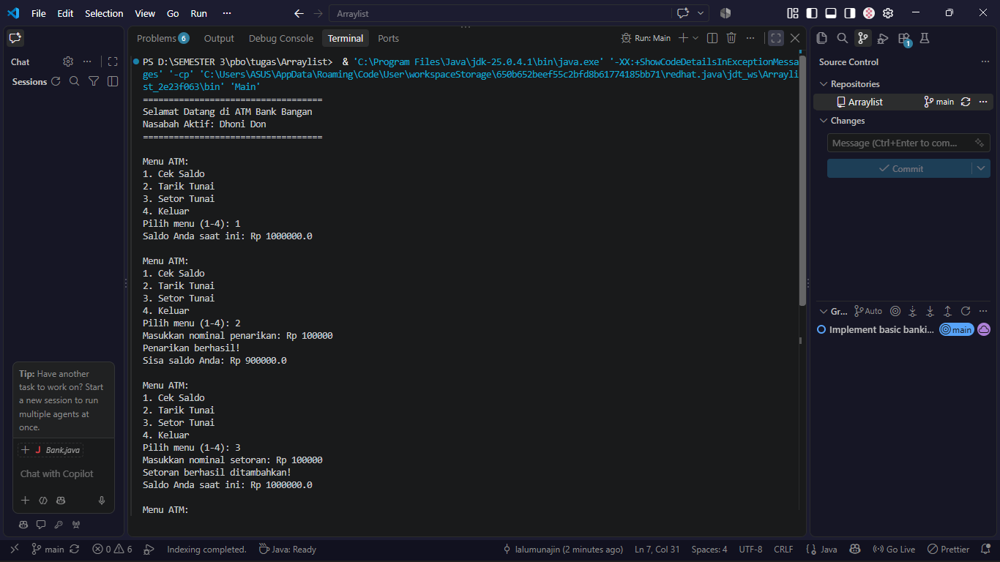

# Java Banking System

Repository ini berisi program simulasi perbankan sederhana menggunakan bahasa pemrograman Java. Program dibuat untuk mempelajari konsep **Pemrograman Berorientasi Objek (PBO)**, khususnya penggunaan class, object, constructor, method, serta pengelolaan data menggunakan array.

## 📚 Materi yang Dipelajari

- **Class dan Object** — memahami kelas sebagai cetak biru dan objek sebagai hasil pembuatannya.
- **Constructor** — menginisialisasi objek saat dibuat.
- **Encapsulation** — mengatur akses terhadap atribut dan method.
- **Array** — menyimpan beberapa objek nasabah dalam satu variabel array.
- **Method** — mengelola data nasabah serta melakukan transaksi.
- **Conditional Statement** — memeriksa kondisi sebelum transaksi dilakukan.

## 📂 Struktur Program

```text
Arraylist/
├── Account.java
├── Bank.java
├── Customer.java
├── Main.java
└── README.md
```

## 💻 Penjelasan Kelas

### 1. Account.java

Kelas `Account` digunakan untuk mengelola informasi saldo dan transaksi rekening.

Fitur yang tersedia:
- Constructor untuk menginisialisasi saldo awal.
- `getBalance()` untuk mendapatkan saldo.
- `deposit(double amount)` untuk menambahkan saldo dengan nominal positif.
- `withdraw(double amount)` untuk melakukan penarikan apabila saldo mencukupi.

Method transaksi mengembalikan nilai `boolean` untuk menunjukkan apakah operasi berhasil dilakukan.

### 2. Customer.java

Kelas `Customer` digunakan untuk merepresentasikan data nasabah.

Kelas ini menjadi bagian dari pengelolaan informasi nasabah yang disimpan oleh kelas `Bank`.

### 3. Bank.java

Kelas `Bank` digunakan untuk mengelola kumpulan data nasabah.

Fitur yang tersedia:
- Menyimpan objek nasabah dalam array dengan kapasitas 10 objek.
- `addCustomer(String f, String l)` untuk menambahkan nasabah selama kapasitas masih tersedia.
- `getNumOfCustomers()` untuk mendapatkan jumlah nasabah.
- `getCustomer(int index)` untuk mengambil objek nasabah berdasarkan indeks.

### 4. Main.java

Kelas `Main` merupakan bagian utama program yang digunakan untuk menjalankan dan menguji implementasi kelas-kelas yang tersedia.

## 🔄 Gambaran Hubungan Kelas

```text
       Main
        |
        v
       Bank
        |
        v
     Customer

     Account
```

Diagram tersebut menggambarkan peran umum setiap kelas. Hubungan langsung antara `Customer` dan `Account` perlu disesuaikan dengan implementasi kode yang digunakan.

## ▶️ Cara Menjalankan Program

Pastikan Java Development Kit (JDK) sudah terpasang pada komputer.

Jika semua file berada di folder yang sama dan tidak menggunakan deklarasi `package`, jalankan perintah berikut melalui terminal:

```bash
javac *.java
java Main
```

## 📸 Screenshot Output Program




## 🎯 Kesimpulan

Melalui program ini, konsep dasar PBO dalam Java dipelajari melalui pembagian tanggung jawab ke beberapa kelas. Penggunaan class, object, constructor, method, dan array membantu memahami bagaimana data nasabah serta transaksi rekening dapat dikelola dalam sebuah program sederhana.

---

**Bahasa Pemrograman:** Java  
**Mata Kuliah:** Pemrograman Berorientasi Objek (PBO)  
**Topik:** Class, Object, Method, dan Array
